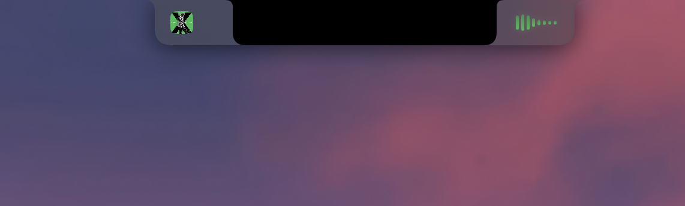
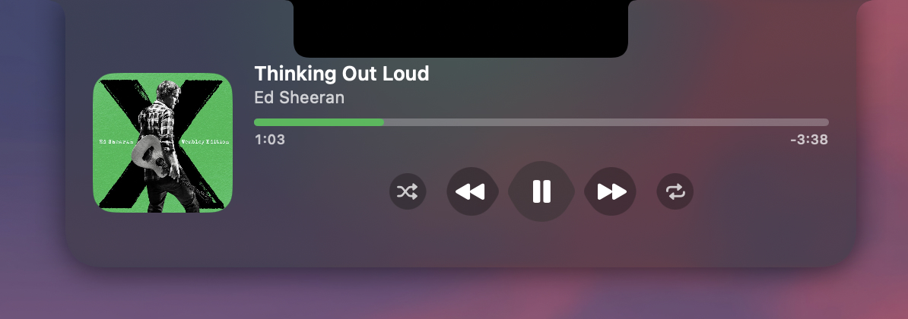

# iNotch

Turn the MacBook notch into a Liquid Glass control center: an Apple Music live activity, a volume HUD, and battery alerts — all living where the notch already is.

Built with SwiftUI for macOS 26 (Tahoe), using the system Liquid Glass material so every surface blurs and color-adapts to whatever is behind it.

## Features

- **Now Playing live activity** — while Apple Music plays, the notch grows small "ears": album artwork on the left, an audio visualizer on the right, tinted to match the current artwork.
- **Hover-expanded player** — hover the notch to drop down a full Liquid Glass player: artwork, title/artist, a seekable progress bar, and previous/play/next controls. Works even when nothing is playing, so you can start playback without opening Music (the play button launches Music and resumes your last queue).
- **Artwork-adaptive colors** — a built-in dominant-color extractor tints the visualizer, progress bar, play button glass, and a subtle background wash to match the album art, with legibility clamps so it always reads on glass.
- **Volume HUD** — press the volume keys and a compact HUD appears in the notch: speaker glyph on the left, level bar on the right. Tracks held keys smoothly, handles mute, and follows output-device switches (AirPods, external DACs).
- **Brightness HUD** — same idea for the brightness keys (and the Control Center slider): sun glyph plus level bar, right in the notch.
- **Bluetooth banners** — when headphones, a keyboard, or a mouse connects, an iOS-style banner shows the device name and a "Connected" badge.
- **Battery notifications** — charger plug/unplug banners and a low-battery alert at a configurable threshold.
- **Dock icon on demand** — iNotch normally runs invisibly (menu bar only). Opening Settings surfaces a dedicated dock icon; closing the window hides it again.
- **Liquid Glass everywhere it belongs** — every active notch state is real translucent glass over your windows and wallpaper; the idle notch stays pure black so it is indistinguishable from the hardware bezel.

## Screenshots

| Compact live activity | Expanded player | Volume HUD |
| --- | --- | --- |
|  |  |  |

## Requirements

- macOS 26 (Tahoe) or later
- Apple Music app (the Music.app that ships with macOS)
- A MacBook with a notch is recommended — on other Macs, iNotch draws a Dynamic Island-style pseudo notch at the top of the main display
- To build: Xcode 26 and [XcodeGen](https://github.com/yonaskolb/XcodeGen)

## Build & Run

```sh
brew install xcodegen

git clone <your-repo-url>
cd iNotchv3

xcodegen generate
open iNotch.xcodeproj   # then ⌘R
```

Or build from the command line:

```sh
xcodebuild -project iNotch.xcodeproj -scheme iNotch -configuration Debug build
```

### First launch

On the first launch, macOS asks for two permissions:

- **Automation (Apple Events) for Music** — asked on first use of a playback control; this is the only automation iNotch performs. Re-enable later under **System Settings → Privacy & Security → Automation**.
- **Bluetooth** — used only to observe device connections for the notch banners. Re-enable later under **System Settings → Privacy & Security → Bluetooth**.

## Usage

- **Hover the notch** to expand the player; move the cursor away to collapse it. The hover delay is adjustable in Settings.
- **Volume / brightness keys** show the matching HUD for about 1.5 s (the system's own bezel still appears alongside it).
- **Connect a Bluetooth device** and its name pops from the notch for a few seconds.
- **Menu bar icon** (sparkles) → *Settings…* to configure everything: music live activity, hover delay, volume and brightness HUDs, Bluetooth banners, battery notifications, low-battery threshold, and notification duration.
- While Settings is open, iNotch appears in the dock; clicking that dock icon brings Settings back to the front.

## How it works

- **Public APIs almost everywhere.** Apple Music state arrives via the `com.apple.Music.playerInfo` distributed notification and is read with AppleScript — iNotch never launches or polls Music behind your back (the one exception: pressing play when Music isn't running launches it). Bluetooth connections come from IOBluetooth connect notifications. The single exception is the brightness *level*, which has no public API: iNotch reads it (read-only) from the private DisplayServices framework — the same value Control Center shows.
- The notch UI is a borderless, non-activating `NSPanel` pinned over the hardware notch at status-bar level, so it never steals focus from your apps.
- A small state machine (idle → compact → expanded, with volume/brightness/Bluetooth/battery as auto-dismissing transients) drives the SwiftUI content, which morphs between states with springs and Liquid Glass (`glassEffect`, `GlassEffectContainer`, `glassEffectID`).
- Volume changes come from CoreAudio property listeners on the default output device — no polling.
- Artwork accent colors come from a tiny dominant-color extractor: the artwork is downsampled to 24×24, bucketed, scored with a saturation bias, and clamped for contrast on dark glass.

## Limitations

- Apple Music only — Spotify and other players don't emit the notification iNotch listens for (yet).
- The macOS system volume/brightness bezels still appear alongside the notch HUDs; suppressing them would require private-API hacks that iNotch deliberately avoids.
- Bluetooth banners cover classic Bluetooth (headphones, AirPods) plus BLE keyboards and mice (detected as HID devices); BLE-only accessories that aren't input devices (e.g. some heart-rate or game controllers) may not trigger a banner.
- The brightness HUD tracks the built-in display only.
- One display at a time: the notch UI lives on the built-in (or main) display.
