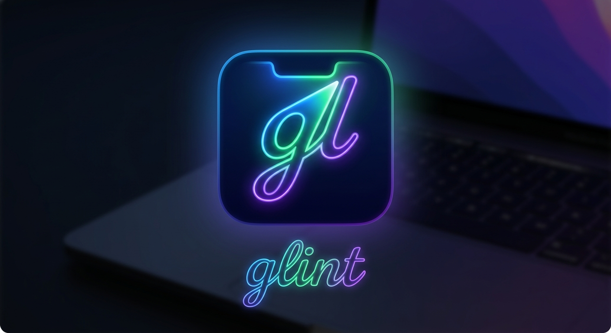
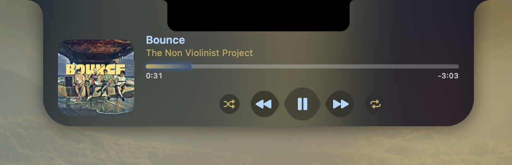
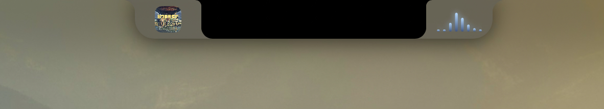
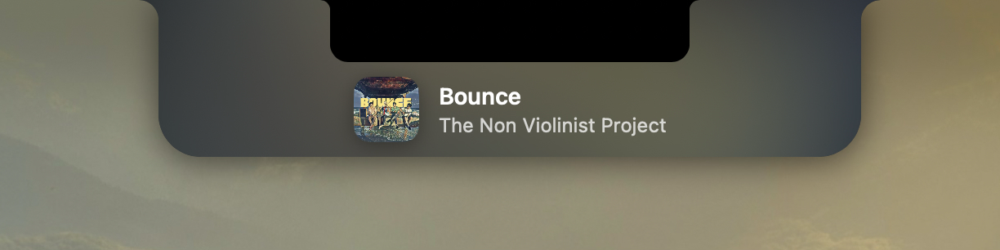
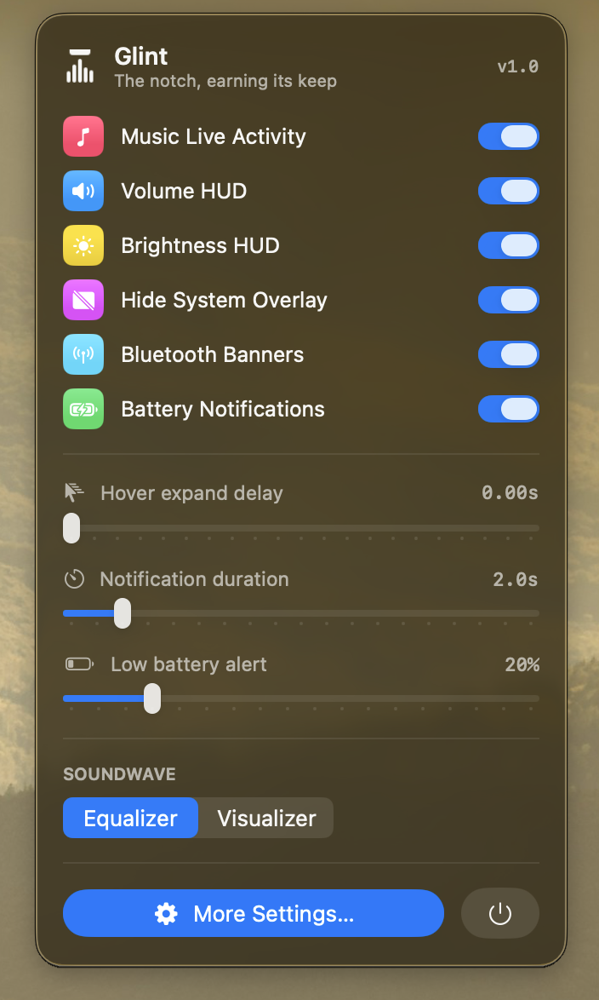
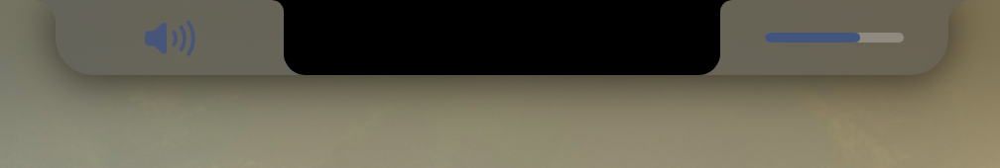
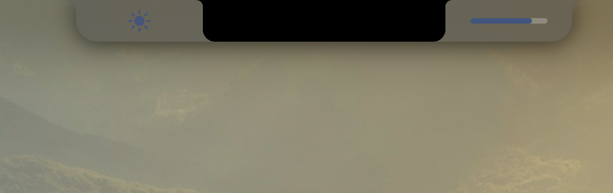
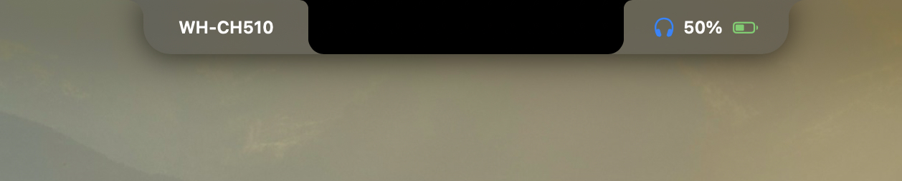
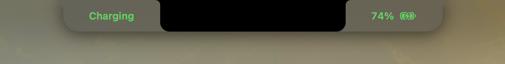

<div align="center">



# Glint

### The MacBook notch, finally earning its keep.

**A Liquid Glass control center that lives inside the black rectangle Apple gave you** — Apple Music live activity with a real‑audio equalizer, volume &amp; brightness HUDs, Bluetooth banners, and battery alerts, all blooming out of the notch and adapting to whatever's playing.

<br>


**[✨ Features](#-features) · [📸 Screenshots](#-screenshots) · [💿 Install](#-installation) · [🎮 Usage](#-usage) · [🛠 Requirements](#-requirements) · [🧪 Built with](#-technologies-used)**

</div>

---

## 🔮 Overview

Your Mac's notch does nothing — a hole punched in your display where the menu bar goes to die. **Glint turns that dead void into the most useful three centimeters of your screen.**

When nothing's happening, the notch stays **pure black**, indistinguishable from the hardware bezel. When something *is* happening — a track change, a volume tap, a charger plugged in, a headset connecting — Glint blooms out of the notch in real, honest **Liquid Glass** (`glassEffect`, `GlassEffectContainer`, `glassEffectID`), color‑adapting to your album art and refracting whatever's behind it. Built from scratch in SwiftUI for **macOS 26 (Tahoe)**.

It runs entirely from the menu bar, keeps **zero telemetry**, and greets you with a neon **glint** signature every time it launches.

---

## ✨ Features

### 🎵 Apple Music & Spotify, where your eyes already are
- **Now Playing live activity** — while Apple Music or Spotify plays, the notch grows small *ears*: album artwork on the left, a soundwave on the right, tinted to the current cover.
- **Real‑audio equalizer** — the default soundwave taps the active media player's output through a Core Audio process tap and runs an FFT, so **bass thumps the left bars and vocals ripple the right ones**. Prefer a procedural look? Flip to the animated visualizer.
- **Hover‑expanded player** — hover the notch and a full Liquid Glass player drops down: artwork, title/artist, a **seekable** progress bar, and shuffle / previous / play / next / repeat. The play button *morphs* into pause, skip glyphs bounce, and active shuffle/repeat glow in the album's color.
- **Song‑change banner** — change tracks and a compact drop‑down card announces the new song, artwork and all.
- **Artwork‑adaptive everything** — a built‑in dominant‑color extractor tints the visualizer, progress bar, play‑button glass, and a subtle background wash to match the cover, with legibility clamps so it always reads on glass.

### 🎛 HUDs that replace the macOS pill
- **Volume HUD** — speaker glyph + level bar, right in the notch. Tracks held keys smoothly, handles mute, follows output‑device switches.
- **Brightness HUD** — sun glyph + level bar; reacts to **key presses only**, so auto‑brightness stays silent.
- **System‑overlay replacement** — Glint handles the volume/brightness keys itself, so the macOS Control Center pill **never appears**. One toggle brings it back; quitting always restores it.

### 📡 Banners &amp; alerts that don't nag
- **Bluetooth banners** — connect AirPods, headphones, a keyboard, or a mouse and an iOS‑style banner shows the **device name, icon, and battery %**. Wired EarPods are recognized too (with an EarPods glyph).
- **Battery notifications** — charger plug/unplug banners, a configurable **low‑battery alert**, a **Fully Charged** banner at 100%, and a **Charge Limit** banner when macOS deliberately stops early.

### 🪟 Control &amp; polish
- **Menu‑bar control panel** — a mini control center: switches for every module, live sliders (hover delay, notification duration, low‑battery threshold), a soundwave‑style picker, and a **More Settings…** button.
- **Launch greeting** — a premium neon **glint** signature writes itself in on every launch, then dissolves.
- **Dock icon on demand** — Glint runs invisibly; open Settings and a Dock icon appears, close it and it vanishes.
- **Zero telemetry** — no analytics, no network calls. The equalizer FFT runs locally; nothing is stored or sent anywhere.

---

## 📸 Screenshots

<div align="center">

<table>
  <tr>
    <td align="center" width="50%"><br><b>Hover‑expanded player</b><br><sub>artwork · seekable progress · glass transport controls</sub></td>
    <td align="center" width="50%"><br><b>Now Playing live activity</b><br><sub>album art + real‑audio equalizer, tinted to the cover</sub></td>
  </tr>
  <tr>
    <td align="center"><br><b>Song‑change banner</b><br><sub>the new track drops down from the notch</sub></td>
    <td align="center"><br><b>Menu‑bar control panel</b><br><sub>switches, sliders, and More Settings…</sub></td>
  </tr>
  <tr>
    <td align="center"><br><b>Volume HUD</b><br><sub>replaces the macOS Control Center pill</sub></td>
    <td align="center"><br><b>Brightness HUD</b><br><sub>key presses only — never auto‑brightness</sub></td>
  </tr>
  <tr>
    <td align="center"><br><b>Bluetooth banner</b><br><sub>device name, icon, and battery % on connect</sub></td>
    <td align="center"><br><b>Battery &amp; charging banner</b><br><sub>plug / unplug · low battery · fully charged · charge limit</sub></td>
  </tr>
</table>

</div>

---

## 💿 Installation

> [!IMPORTANT]
> **Important Note:** We do not currently have a verified Apple Developer account, so the Glint application will be blocked by macOS on its first launch. To bypass this, you need to open the app by clicking **"Open Anyway"** in **Privacy & Security** under macOS Settings.
>
> Please be reassured that all permissions required for Glint are completely local. **Glint does not collect any user data or send any information anywhere.** Building from source skips Gatekeeper entirely.

1. **Download** `Glint-1.0.dmg` from the [releases page](../../releases), open it, and drag **Glint** onto **Applications**.
2. **Open** Glint from Applications. macOS refuses *("cannot be opened" / "could not verify it is free of malware")*. Click **Done** — ***not*** "Move to Trash".
3. Open **System Settings → Privacy & Security**, scroll to the bottom, and click **"Open Anyway"** next to the Glint message, then confirm.
4. **Open Glint again** — it launches normally from now on. Grant the four permissions it asks for (see [Requirements](#-requirements)).

<details>
<summary><b>⚡ Terminal shortcut for steps 2–3</b></summary>

```sh
xattr -dr com.apple.quarantine /Applications/Glint.app
```
</details>

<details>
<summary><b>🛠 Build from source</b> (skips Gatekeeper entirely)</summary>

Requires macOS 26, Xcode 26, and [XcodeGen](https://github.com/yonaskolb/XcodeGen).

```sh
brew install xcodegen
git clone https://github.com/Roots26Hz/iNotch.git
cd iNotch
xcodegen generate
open Glint.xcodeproj   # then ⌘R
```

Package a signed release DMG (needs `create-dmg`): `scripts/package-dmg.sh`.
The app icon and DMG artwork are **generated code** — `swift scripts/generate-icon.swift` and `swift scripts/generate-dmg-background.swift` re‑render them from `docs/GLINTLOGOANDARTWORK.png`.
</details>

---

## 🎮 Usage

- **🖱 Hover the notch** to expand the player; move away to collapse. Hover delay is adjustable.
- **🔊 Volume / brightness keys** show the matching HUD in the notch. The system pill stays hidden by default (one toggle brings it back). Brightness reacts to key presses only.
- **🎧 Connect a Bluetooth device** — name, icon, and battery level pop from the notch for a few seconds.
- **🔋 Plug / unplug the charger** — a banner shows charge state; low‑battery, fully‑charged, and charge‑limit banners fire automatically.
- **📋 Menu‑bar icon** (the *gl* monogram) → a control panel with every toggle and slider, plus **More Settings…** for the full window and Visualizer Studio.

---

## 🛠 Requirements

- **macOS 26 (Tahoe)** or later
- The **Apple Music** or **Spotify** app
- A MacBook with a **notch** — on other Macs, Glint draws a Dynamic Island‑style pseudo‑notch on the main display

On first launch macOS asks for four permissions. Every one is **read‑only or purely local** — Glint collects nothing.

| Permission | Why |
| --- | --- |
| 🎵 **Automation (Music / Spotify)** | Play / pause / skip via AppleScript — the only automation it performs. |
| 🎧 **Bluetooth** | Observe device connections for the notch banners. |
| ♿️ **Accessibility** | Notice manual brightness/volume keys and hide the system pill. *Relaunch after granting.* |
| 🎙 **System Audio Recording** | Feed the equalizer FFT. Denied → silently falls back to the animated visualizer. |

---

## 🧪 Technologies Used

`SwiftUI` · `Liquid Glass (glassEffect / GlassEffectContainer / glassEffectID)` · `AppKit (NSPanel)` · `Core Audio (process tap + property listeners + FFT)` · `IOBluetooth` · `IOHIDManager` · `IOKit power sources` · `CGEvent taps` · `DisplayServices` · `AppleScript` · `XcodeGen`

---

## 🗺 Roadmap

- Launch at login
- Notarized distribution (needs a paid Developer ID)
- More Visualizer Studio presets

---

## 📄 License

Released under the MIT License. Not affiliated with Apple.

<div align="center">
<sub><b>Glint</b> — because the notch was always meant to <b>do something</b>. 🖤</sub>
</div>
