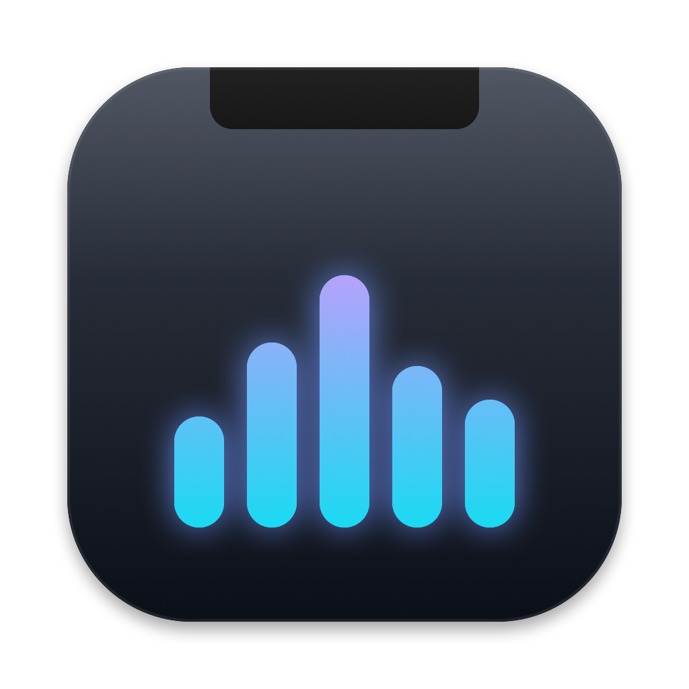
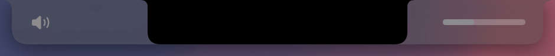
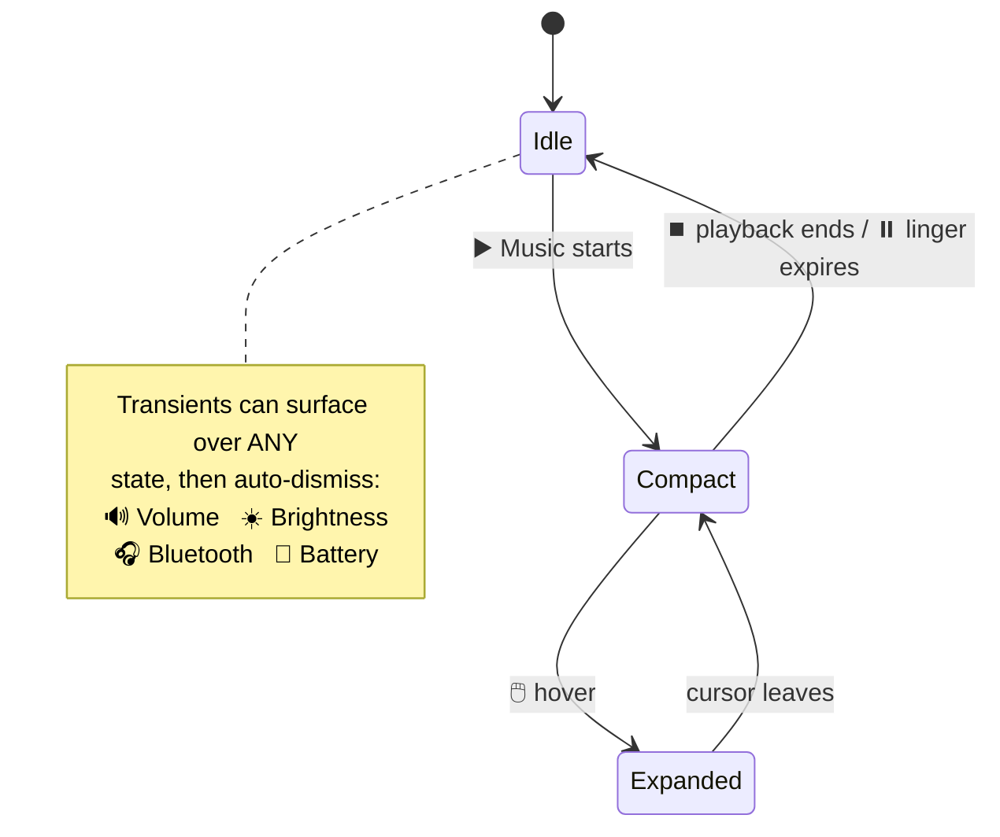
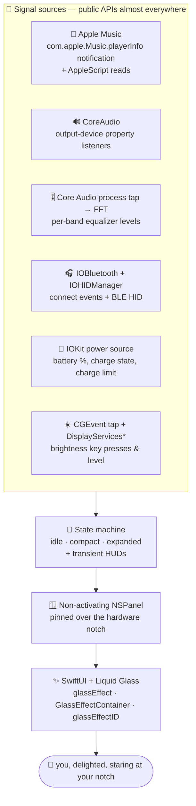

<div align="center">



# iNotch

### The MacBook notch, finally earning its keep.

**A Liquid Glass control center that lives inside the black rectangle Apple gave you** — Apple Music live activity, a real-audio equalizer, volume &amp; brightness HUDs, Bluetooth banners, and battery alerts — all blooming out of the notch and blurring into whatever's behind them.

<br>


-red?style=flat-square)


<br>

**[✨ Features](#-features) · [📸 Screenshots](#-screenshots) · [🧠 How it works](#-how-it-works) · [💿 Install](#-install-dmg) · [🛠 Build](#-build--run) · [🔐 Permissions](#-first-launch--permissions) · [❓ FAQ](#-faq)**

</div>

---

> Your Mac's notch does nothing. It's a hole punched in your display where the menu bar goes to die.
> **iNotch turns that dead pixel-void into the most useful three centimeters of your screen** — and it does it all in real, honest-to-Tahoe Liquid Glass, so every surface blurs, refracts, and color-adapts to your wallpaper and windows underneath.

Built from scratch in **SwiftUI for macOS 26 (Tahoe)**, using the system Liquid Glass material (`glassEffect`, `GlassEffectContainer`, `glassEffectID`) — not a fake blur, not a screenshot trick. When nothing's happening, the notch stays **pure black**, indistinguishable from the hardware bezel. When something *is* happening, it comes alive.

<br>

## ✨ Features

### 🎵 The music, where your eyes already are

<table>
<tr>
<td width="50%" valign="top">

**Now Playing live activity**
While Apple Music plays, the notch grows small **"ears"** — album artwork on the left, a soundwave on the right, tinted to match the current cover.

The default soundwave is a **real equalizer**: iNotch taps Music's audio output and runs an FFT, splitting it into frequency bands so **bass thumps the left bars and vocals ripple the right ones.** Prefer the classic look? Flip to the animated visualizer in Settings.

Pausing doesn't slam the notch shut — the activity **lingers with frozen bars** for a couple of minutes (adjustable) so a quick resume feels seamless.

</td>
<td width="50%" valign="top">

**Hover-expanded player**
Hover the notch and a **full Liquid Glass player** drops down: artwork, title/artist, a seekable progress bar, and shuffle / previous / play / next / repeat.

Everything is **springy and fluid** — the play button *morphs* into pause, skip glyphs bounce, and active shuffle/repeat **glow in the album's color.**

Works even when nothing's playing, so you can **start playback without ever opening Music** — the play button launches it and resumes your last queue.

</td>
</tr>
</table>

**🎨 Artwork-adaptive everything** — a built-in dominant-color extractor tints the visualizer, progress bar, play-button glass, and a subtle background wash to match the album art, with legibility clamps so it always reads on glass.

### 🎛 The HUDs that replace macOS's own

| | What it does |
|---|---|
| **🔊 Volume HUD** | Speaker glyph + level bar, right in the notch. Tracks held keys smoothly, handles mute, and follows output-device switches (AirPods, external DACs). |
| **☀️ Brightness HUD** | Sun glyph + level bar. **Keyboard changes only** — auto-brightness (ambient light) stays silent, exactly as it should. |
| **🫥 Overlay replacement** | By default iNotch handles the volume/brightness keys itself, so the macOS Control Center pill **never appears** — the notch HUDs are the only ones you see. One toggle brings the system overlay back instantly, and quitting always restores it. |

### 📡 Banners &amp; alerts that don't nag

- **🎧 Bluetooth banners** — connect headphones, a keyboard, or a mouse and an iOS-style banner shows the **device name, icon, and battery %** (a "Connected" badge stands in for devices that don't report battery).
- **🔋 Battery notifications** — charger plug/unplug banners, a configurable **low-battery alert**, a **Fully Charged** banner at 100%, and a **Charge Limit** banner when macOS deliberately stops early (the macOS 26 charge-limit setting, or an Optimized Battery Charging hold).
- **🪟 Dock icon on demand** — iNotch runs invisibly (menu bar only). Open Settings and a dock icon appears; close the window and it vanishes again.
- **💎 Liquid Glass everywhere it belongs** — every *active* notch state is real translucent glass over your windows and wallpaper. The idle notch stays pure black, so it's invisible against the bezel.

<br>

## 📸 Screenshots

<div align="center">

| Compact live activity | Expanded player | Volume HUD |
| :---: | :---: | :---: |
|  |  |  |
| *album art + live equalizer* | *full glass player, artwork-tinted* | *speaker glyph + level bar* |

</div>

<br>

## 🧠 How it works

Most notch apps are a pretty overlay with a stopwatch behind them. iNotch is a small, honest state machine wired straight into the system's real signal sources — **public APIs almost everywhere**, with only two tiny read-only exceptions.

### The state machine

A borderless, **non-activating** `NSPanel` is pinned over the hardware notch at status-bar level, so it renders your content **without ever stealing focus** from the app you're using. A compact state machine drives what's inside it:



Idle → compact → expanded, with volume/brightness/Bluetooth/battery riding on top as **auto-dismissing transients**. The SwiftUI content morphs between states with springs and Liquid Glass (`glassEffect`, `GlassEffectContainer`, `glassEffectID`).

### Where the signals come from



<sub>*The only two spots without a public API — both **read-only**: the brightness *level* (private `DisplayServices`, the same value Control Center shows) and Bluetooth accessory battery (the accessory power-source list, what `pmset -g accps` prints).*</sub>

### The details that matter

- **🎵 Music** arrives via the `com.apple.Music.playerInfo` distributed notification and is read with AppleScript — iNotch **never launches or polls Music behind your back.** The one exception: pressing play when Music isn't running launches it (you asked for it).
- **🎚️ The equalizer** taps Music's output with a **Core Audio process tap** — the same public API screen recorders use for app audio — and runs a tiny FFT for per-band levels. Capture **starts when the live activity appears and stops the instant playback pauses.** Nothing is stored, nothing is sent anywhere; macOS shows its recording indicator while music plays.
- **🔊 Volume** comes from CoreAudio property listeners on the default output device — **no polling.**
- **🫥 Hiding the system overlay:** on macOS 26 the volume/brightness pill is drawn by Control Center (the old OSDUIHelper bezel is gone), so the only clean way to suppress it is to make sure Control Center **never sees the key.** iNotch's event tap consumes the key at the HID level and applies the change itself — CoreAudio's virtual main volume (same **1/16 steps**, **¼-steps with ⌥⇧**, mute toggle, optional key-click feedback) and DisplayServices for brightness. Toggle the setting off and every key passes through untouched.
- **☀️ Brightness key presses** are noticed through a CGEvent tap that passes **every event straight through, untouched** (hence the Accessibility permission — macOS's global event monitors never deliver these keys).
- **🎨 Accent colors** come from a tiny extractor: artwork is downsampled to **24×24**, bucketed, scored with a saturation bias, and clamped for contrast on dark glass.

<br>

## 💿 Install (DMG)

> [!IMPORTANT]
> The DMG app is a **universal binary** (Apple Silicon + Intel) but is **not notarized** — that needs a paid Apple Developer account — so macOS blocks the *very first* open on any Mac that downloaded it. Unblocking is a **one-time, four-step dance** (also shipped as `HOW TO INSTALL.txt` inside the DMG).

1. **Download** `iNotch-<version>.dmg` from the [releases page](../../releases), open it, and drag **iNotch** onto **Applications**.
2. **Open** iNotch from Applications. macOS will refuse *("cannot be opened" / "could not verify it is free of malware")*. Click **Done** — ***not*** "Move to Trash".
3. Within an hour, open **System Settings → Privacy &amp; Security**, scroll to the bottom, and click **"Open Anyway"** next to the iNotch message, then confirm.
4. **Open iNotch again** — it launches normally from now on. Grant the four permissions it asks for (see [below](#-first-launch--permissions)).

<details>
<summary><b>⚡ Terminal shortcut for steps 2–3</b></summary>

```sh
xattr -dr com.apple.quarantine /Applications/iNotch.app
```

Building from source skips all of this entirely.
</details>

<br>

## 🛠 Build &amp; Run

**Requirements:** macOS 26 (Tahoe)+, the Apple Music app, Xcode 26, and [XcodeGen](https://github.com/yonaskolb/XcodeGen). A MacBook with a notch is recommended — on other Macs, iNotch draws a **Dynamic Island-style pseudo-notch** at the top of the main display.

```sh
brew install xcodegen

git clone <your-repo-url>
cd iNotchv3

xcodegen generate
open iNotch.xcodeproj   # then ⌘R
```

<details>
<summary><b>Command-line build</b></summary>

```sh
xcodebuild -project iNotch.xcodeproj -scheme iNotch -configuration Debug build
```
</details>

<details>
<summary><b>Packaging a release &amp; regenerating the icon</b></summary>

`scripts/package-dmg.sh` builds a Release app and wraps it in a drag-to-install DMG at `dist/iNotch-<version>.dmg` (needs `brew install xcodegen create-dmg`).

The app icon is **generated code** — `swift scripts/generate-icon.swift` re-renders every size in the asset catalog plus `docs/icon.png`.
</details>

<br>

## 🔐 First launch &amp; permissions

On first launch, macOS asks for four permissions. Every one is **read-only or purely local** — iNotch collects nothing and phones home never.

| Permission | Why iNotch needs it | Re-enable under |
| --- | --- | --- |
| 🎵 **Automation (Music)** | Play/pause/skip via AppleScript — the *only* automation it performs. Asked on first use of a playback control. | Privacy &amp; Security → Automation |
| 🎧 **Bluetooth** | Observe device connections for the notch banners. Nothing else. | Privacy &amp; Security → Bluetooth |
| ♿️ **Accessibility** | Notice **manual** brightness key presses (so the HUD skips auto-brightness) and, when overlay-hiding is on, handle the volume/brightness keys in Control Center's place. **Relaunch after granting.** | Privacy &amp; Security → Accessibility |
| 🎙 **System Audio Recording** | Feed the equalizer FFT with Music's output. Nothing is stored or sent; the menu-bar recording indicator shows while music plays. **Denied → silently falls back to the animated visualizer.** | Privacy &amp; Security → Screen &amp; System Audio Recording |

<br>

## 🎮 Usage

- **🖱 Hover the notch** to expand the player; move away to collapse. Hover delay is adjustable.
- **🔊 Volume / brightness keys** show the matching HUD for ~1.5 s. The system bezel is hidden by default (toggle to bring it back). Brightness HUD reacts to key presses only, never auto-brightness.
- **🎧 Connect a Bluetooth device** — name, icon, and battery level pop from the notch for a few seconds.
- **⏸ Pause playback** — the activity lingers with frozen bars for two minutes (slider: **15 s – 5 min**), then goes idle. Resuming, stopping, or quitting Music ends the linger early.
- **📋 Menu bar icon** (the notch-and-equalizer glyph) → *Settings…* configures **everything**: live activity, soundwave style (live equalizer vs animated), hover delay, paused-player linger, both HUDs, overlay hiding, Bluetooth banners, battery notifications, low-battery threshold, and notification duration.
- While Settings is open, iNotch shows in the dock; clicking that icon brings Settings to the front.

<br>

## 🧩 Limitations

Honest ones, no asterisks:

- **Apple Music only** — Spotify &amp; friends don't emit the notification iNotch listens for (*yet*).
- **Overlay hiding needs Accessibility** — without it, the macOS overlay just appears as normal. Keys iNotch can't act on (brightness with no controllable built-in display; volume on devices without a volume control) automatically fall through to macOS.
- **Bluetooth banners** cover classic BT (headphones, AirPods) plus BLE keyboards/mice (as HID). BLE-only non-input accessories (some heart-rate straps, game controllers) may not trigger a banner; battery % depends on the device reporting it — otherwise it shows "Connected".
- **Equalizer** needs System Audio Recording and shows the recording indicator while playing. Switch output devices mid-song and the bars freeze? A quick pause/play restarts capture.
- **Brightness HUD** tracks the built-in display only.
- **One display at a time** — the notch UI lives on the built-in (or main) display.

<br>

## ❓ FAQ

<details>
<summary><b>Is this spying on my music / audio / anything?</b></summary>

No. The equalizer runs a local FFT on Music's output purely to draw bars — **nothing is stored, nothing is sent anywhere**, and macOS shows its recording indicator the whole time so you can see exactly when it's active. There's no telemetry, no analytics, no network calls at all.
</details>

<details>
<summary><b>Why does it need Accessibility just for brightness?</b></summary>

macOS's global event monitors **don't deliver brightness/volume media keys** — the only way to notice them is a CGEvent tap, which requires Accessibility. iNotch's tap passes every event straight through untouched unless you've enabled overlay-hiding, in which case it consumes the key and applies the change itself.
</details>

<details>
<summary><b>I don't have a notch. Can I still use it?</b></summary>

Yes — on Macs without a hardware notch, iNotch draws a **Dynamic Island-style pseudo-notch** at the top of your main display.
</details>

<details>
<summary><b>"Cannot be opened / could not verify it is free of malware" — is it broken?</b></summary>

Nope, that's just Gatekeeper being cautious about an unnotarized app (notarization needs a paid Apple Developer account). Follow the [four-step install dance](#-install-dmg) or run `xattr -dr com.apple.quarantine /Applications/iNotch.app`. Building from source avoids it completely.
</details>

<details>
<summary><b>Will you support Spotify?</b></summary>

It's the most-wanted thing on the list — the blocker is that Spotify doesn't emit the same distributed notification Apple Music does. Not impossible, just not here *yet*.
</details>

<br>

## 🧪 Built with

`SwiftUI` · `Liquid Glass (glassEffect / GlassEffectContainer / glassEffectID)` · `AppKit (NSPanel)` · `Core Audio (process tap + property listeners + FFT)` · `IOBluetooth` · `IOHIDManager` · `IOKit power sources` · `CGEvent taps` · `DisplayServices` · `AppleScript` · `XcodeGen`

<br>

---

<div align="center">

**iNotch** — because the notch was always meant to *do* something.

<sub>Made for the hole in your display. 🖤</sub>

</div>
